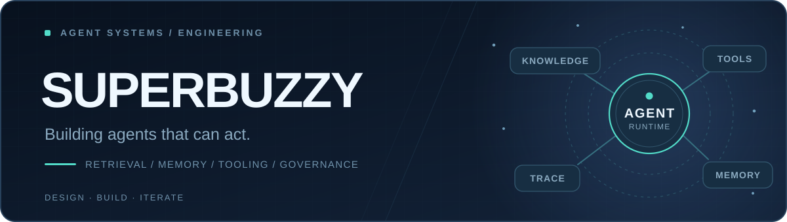
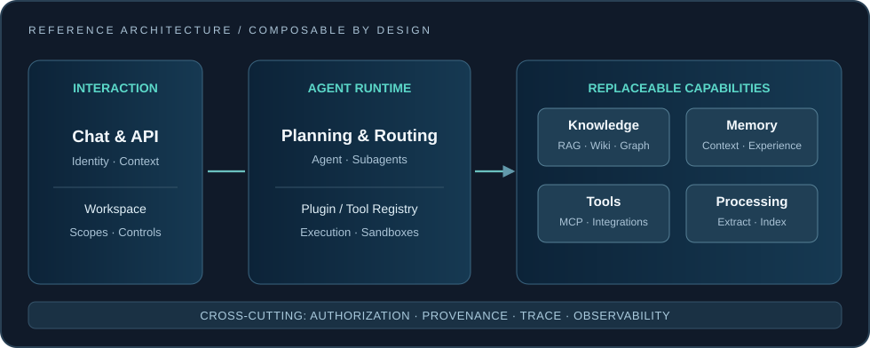

<picture>
  <source media="(prefers-color-scheme: dark)" srcset="./assets/hero-dark.svg" />
  <source media="(prefers-color-scheme: light)" srcset="./assets/hero-light.svg" />
  
</picture>

 

**AI Agent Engineering · Knowledge Systems · Extensible Architecture**

从智能体编排到知识与记忆，让复杂 AI 系统真正可用、可扩展、可治理。

---

### About / 关于我

I design and build **extensible AI agent systems** — bridging agent runtimes, enterprise knowledge, persistent memory, and real-world workflows.

关注 AI 智能体系统的工程落地：**运行时编排、插件机制、知识构建、图谱检索、长期记忆、访问控制和执行可观测性**。相比单点演示，我更关心这些能力如何组合为可持续演进的系统。

### What I'm building / 核心方向

| | Direction | Engineering focus |
| :---: | --- | --- |
| ◈ | **Agent Runtime** | 多智能体协作、任务编排、工具调用、沙箱执行与生命周期管理 |
| ◇ | **Knowledge Engineering** | 文档摄入、知识提取、结构化知识、实体关系及可追溯引用 |
| ⬡ | **Retrieval Architecture** | 文档证据、知识条目、图谱关系检索；检索范围控制与结果融合 |
| ✳ | **Persistent Memory** | 长期上下文、经验沉淀、记忆检索、知识回流与反馈闭环 |
| ⧉ | **Plugin & Extension Systems** | Provider 解耦、工具可插拔、可选管理模块与独立前端页面 |
| ◎ | **Governance & Observability** | 多层级空间、授权边界、处理流水线、执行 Trace 与问题诊断 |

### Architecture

  

**Design principles:** modular capabilities · replaceable providers · least-privilege access · attributable knowledge · observable execution.

### Open-source collaboration

正在围绕 [**DeerFlow Knowledge 扩展**](https://github.com/bytedance/deer-flow/issues/6269) 参与方案讨论与增量实现：

- **Retrieval** — 统一 Tool 机制下的文档、知识条目与实体关系检索
- **Knowledge pipeline** — 可选接入的摄入、处理与知识增强能力
- **Plugin-first UX** — 后端能力与管理页面解耦，按需安装、分别启停
- **Scope & Trace** — 授权范围、证据来源与处理过程可追溯

> 这里展示的是参与讨论与持续探索的技术方向，不代表相关功能均已合并或发布。

### Tech stack

### Contribution trail / 持续构建

<picture>
  <source media="(prefers-color-scheme: dark)" srcset="https://raw.githubusercontent.com/superbuzzy/superbuzzy/output/github-contribution-grid-snake-dark.svg" />
  <source media="(prefers-color-scheme: light)" srcset="https://raw.githubusercontent.com/superbuzzy/superbuzzy/output/github-contribution-grid-snake.svg" />
  
</picture>

GitHub Actions 自动生成的贡献贪吃蛇。初次生成前可能暂时不显示。

---

Build with intention. Keep systems open to change.

